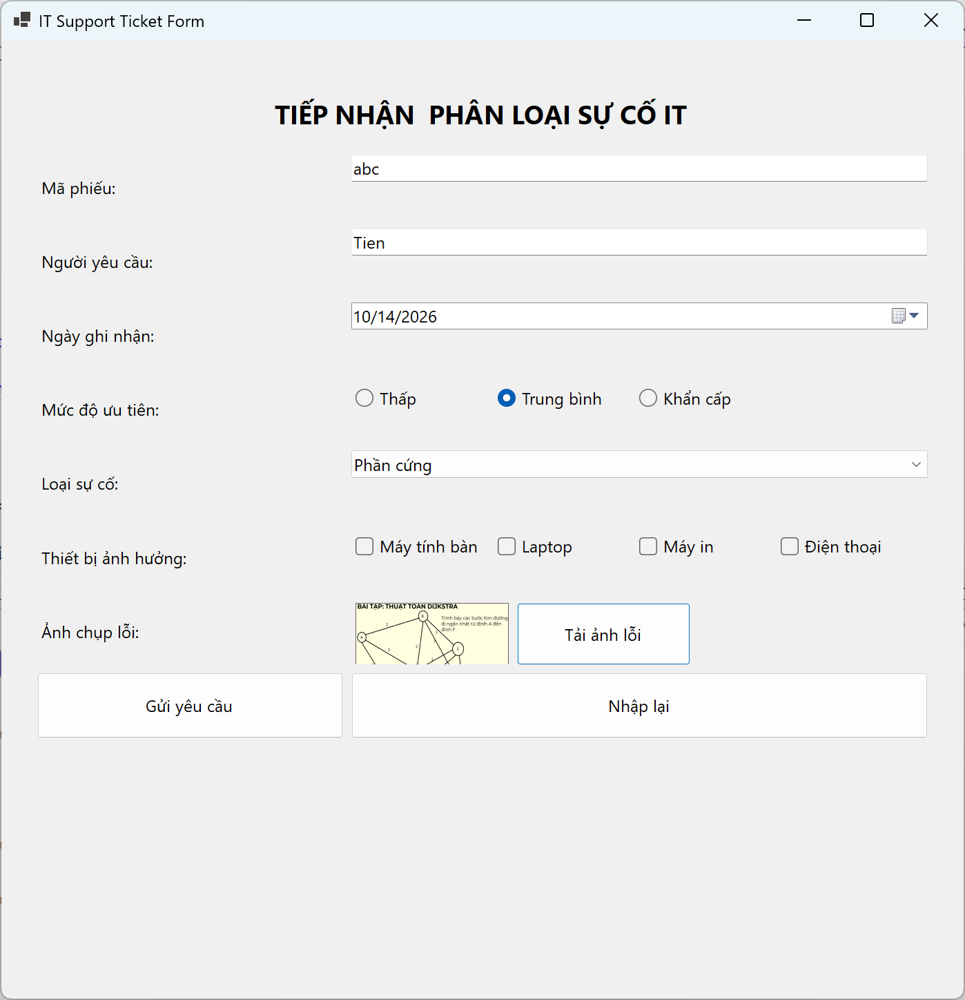
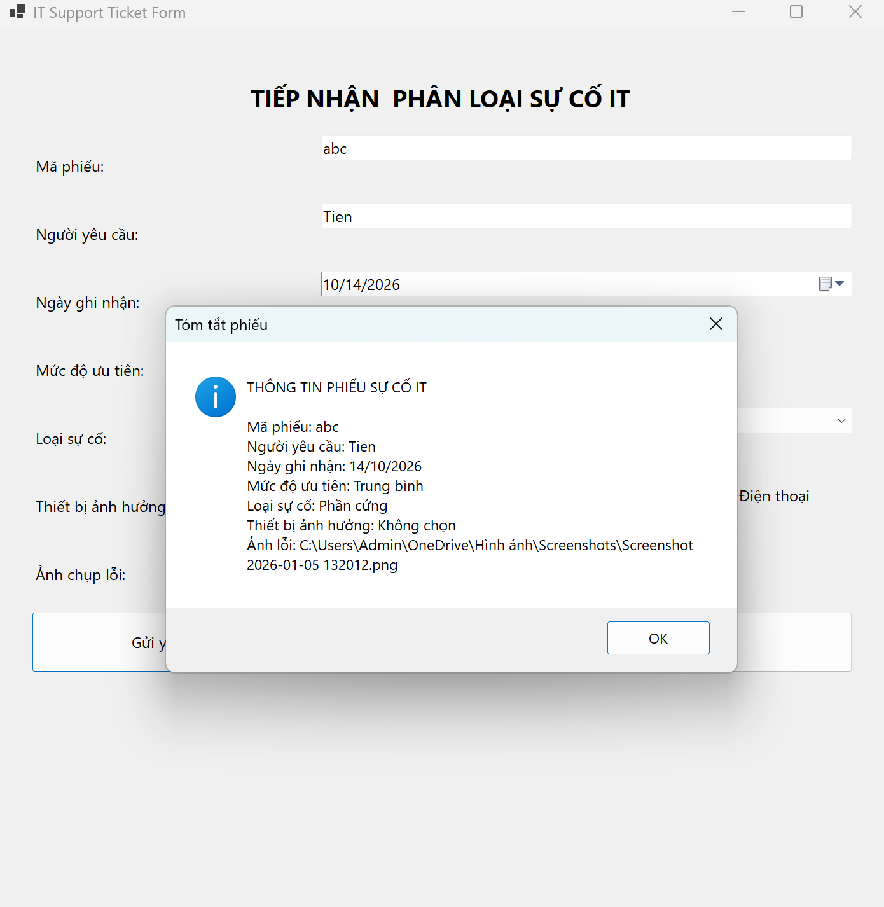
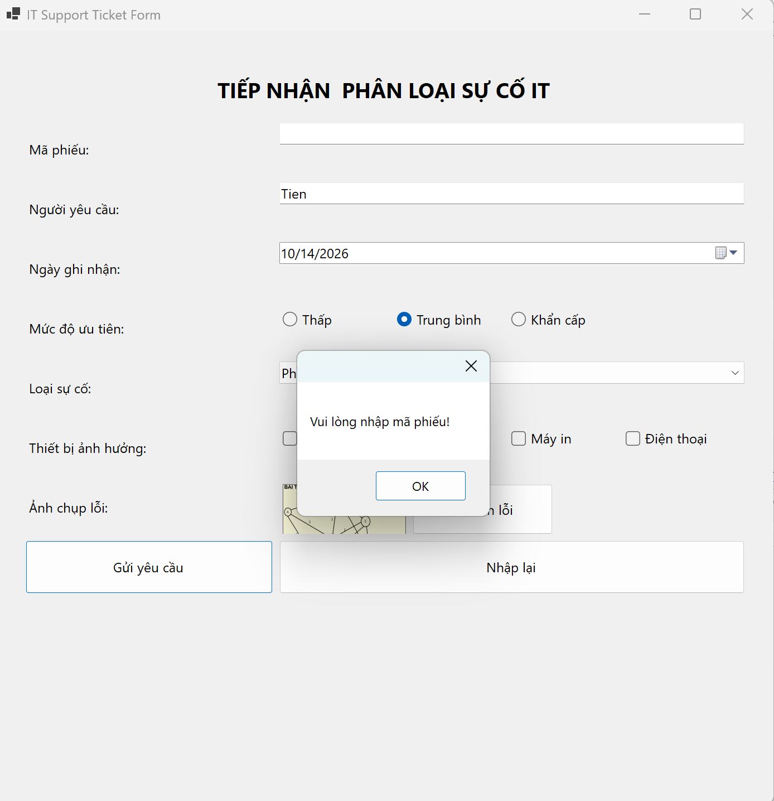

# BÁO CÁO BÀI TẬP 
## THÔNG TIN SINH VIÊN
- **Họ và tên:** Nguyễn Văn Tiến
- **Mã số sinh viên:** 24810310274
- **Lớp:** D19-CNPM3
- **Tên môn học:** Lập trình C# / Windows Forms
- **Tên bài tập:** ÔN TẬP WINFORM 14_10_2026

---

## KẾT QUẢ THỰC HÀNH

### 1. Ảnh màn hình Giao diện chính

### 2. Ảnh màn hình Chức năng thực thi / Kết quả

### 3. Ảnh màn hình Kiểm tra lỗi (Validation)

